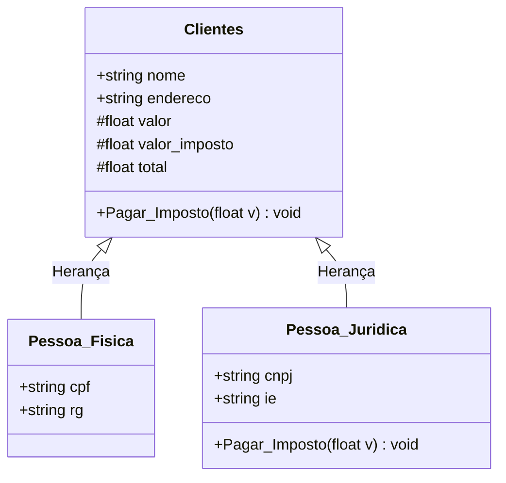

# Sistema de Controle de Clientes (C# / POO)

Projeto prático desenvolvido para o curso de Fullstack (SENAI), focado na implementação dos quatro pilares fundamentais da **Programação Orientada a Objetos (POO)** na linguagem **C#**.

---

## 🎯 Objetivo

Implementar um sistema de console capaz de gerenciar e calcular impostos de clientes divididos em duas categorias:
1. **Pessoa Física (PF):** possui CPF e RG, com alíquota de imposto fixada em **10%** sobre o valor da compra.
2. **Pessoa Jurídica (PJ):** possui CNPJ e Inscrição Estadual (IE), com alíquota de imposto de **20%** sobre o valor da compra.

---

## 📐 Diagrama de Classes



---

## 🧱 Pilares de POO Aplicados

* **Abstração:** Modelagem das entidades do mundo real em classes especializadas (`Clientes`, `Pessoa_Fisica`, `Pessoa_Juridica`), com seus atributos e comportamentos essenciais.
* **Encapsulamento:** Uso do modificador `protected set` para as variáveis `valor`, `valor_imposto` e `total`, garantindo que apenas a classe base e as classes derivadas possam alterar os valores calculados diretamente.
* **Herança:** Reutilização de código onde `Pessoa_Fisica` e `Pessoa_Juridica` herdam todos os atributos e métodos comuns da classe-mãe `Clientes`.
* **Polimorfismo:** O método `Pagar_Imposto` foi definido como `virtual` na classe base e sobrescrito com a palavra-chave `override` na classe `Pessoa_Juridica`, aplicando a regra de negócio específica (20% de tributação) em tempo de execução.

---

## 🚀 Como Executar o Projeto

### Pré-requisitos:
* [.NET SDK](https://dotnet.microsoft.com/download) (versão 8.0 ou superior instalada).

### Passo a passo no terminal:
```bash
# 1. Clonar o repositório
git clone https://github.com/SEU_USUARIO/SistemaControleClientes.git

# 2. Acessar a pasta do projeto
cd SistemaControleClientes

# 3. Executar o sistema
dotnet run
```

---

## 👨‍💻 Autor
* **Daniel Mendonça Paiva**
